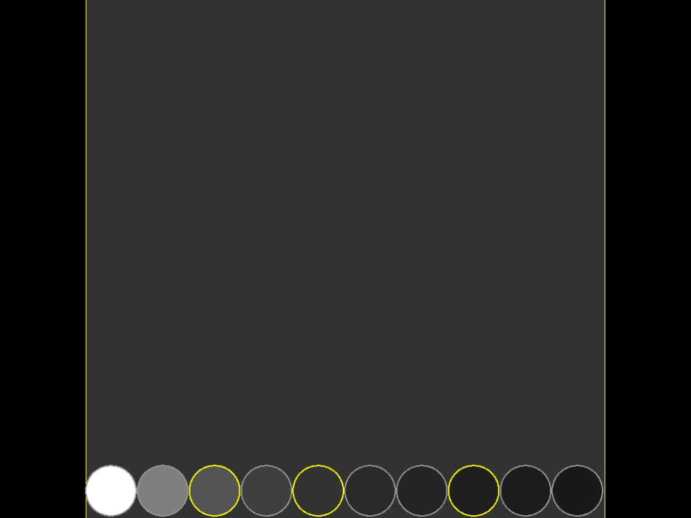

# rythme

A rhythm game prototype (2022): a board with ten frets at its bottom, lit while the number keys 1..9, 0 are held.
SFML 3.1 and ImGui through [kazilib](https://github.com/xkazinx/kazilib) (submodule `src/dep/kazilib`).

**Play it in your browser: https://kazin.dev/projects/rythme/**



## Build

```
powershell -ExecutionPolicy Bypass -File build.ps1
```

`setup.ps1` (run by `build.ps1`) checks out kazilib and links SFML 3.1 (`src\dep\SFML-3.1.0`: a junction to
`D:\code\kazilib\SFML-3.1.0`, else the official 32-bit release, downloaded). Then kazilib's FASTBuild runner builds
`src\fastbuild.json` (kazilib's `ml` version, then rythme): Release, x86, the 64-bit-hosted tools, distributed to the
workers that answer. `-Configuration Debug` builds Debug; `-Regen`, `-Clean`, `-Local` as kazilib's runner says.
Visual Studio: `src\rythme.sln`.

## Run

`deploy\rythme\rythme.exe` (from that folder: `imgui.ini` is there). A borderless 1024x768 window and a console:
hold 1..9, 0 to light the frets; Right Alt + D shows or hides the console; Alt+F4 closes it.

## In a web browser

The same code compiled to WebAssembly with kazilib's web port (`src\dep\kazilib\web\`, its README). The page has
Scaled Window (the default), Original Size and Fullscreen under the game.

```
powershell -ExecutionPolicy Bypass -File build_web.ps1       # src\build\web\rythme-build
powershell -ExecutionPolicy Bypass -File deploy_ubuntu.ps1   # build, upload, install
```

`deploy_ubuntu.ps1` sends the build to the box `kazin-music` with `deploy\ubuntu\`: static files in `/opt/rythme/web`,
served by Caddy (`/etc/caddy/sites/kazin.dev.d/rythme.caddy`). There is no server: the game runs in the page. The
console and its Right Alt + D are the Windows build's only.

## Testing

`src\tests\web\run_web_test.ps1` drives the page in headless Edge through kazilib's `web\tools\browser.js`: one fret,
three held together, one released under the others, all ten at once. `-Url https://kazin.dev/projects/rythme/` runs it
on the live page. Screenshots land in `testerino\web\`.

## From kazilib

- imgui and imgui-SFML (on SFML 3.1), magic_enum, rang, the std names (`stdnames.h`, `v += x`), `Under`, the type
  aliases (`u8`, `u16`, `szt`): the copies this repo had (and the old `kazin` library from `$(LIBPATH)`) are gone.
- Scenes: `lib::scene::Manager` / `lib::scene::Base` (`SceneMgr`, `GameScene`).
- The build: kazilib's FASTBuild runner (`src\fastbuild.json`, `src\Directory.Build.props`), as tictactoe.

`Print` / `PrintDebug` / `PrintError` (the old library's) are rythme's own now (`global.h`, `std::format` and rang).
The old Live++ hooks are gone (no Live++ SDK in this repo).

---

## Original README (2022-01-17, 10d23eb)

# rythme
